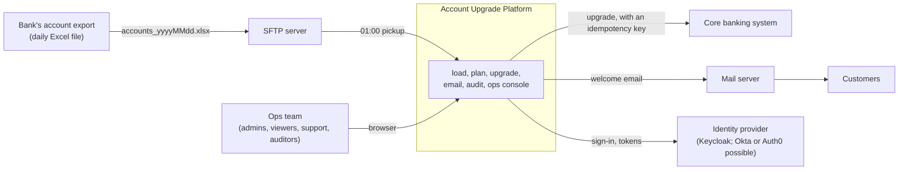
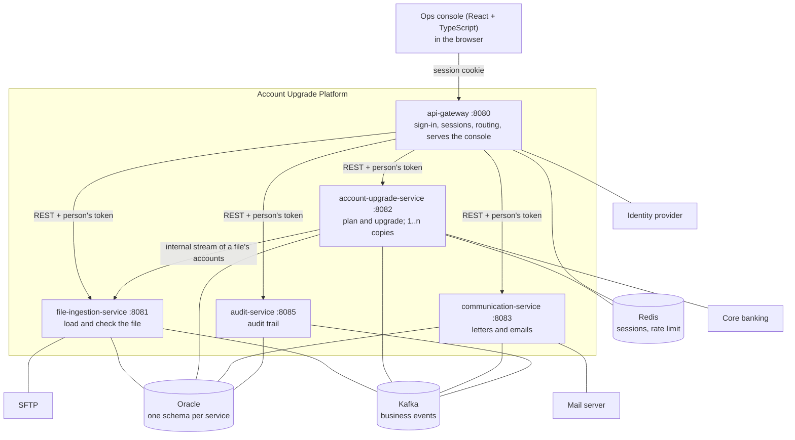
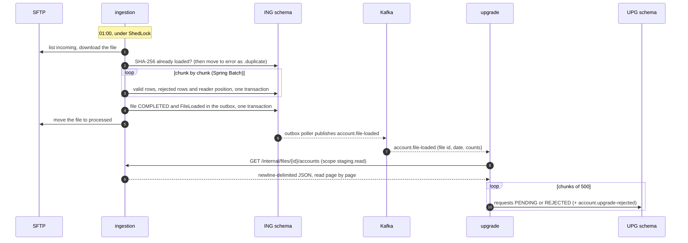
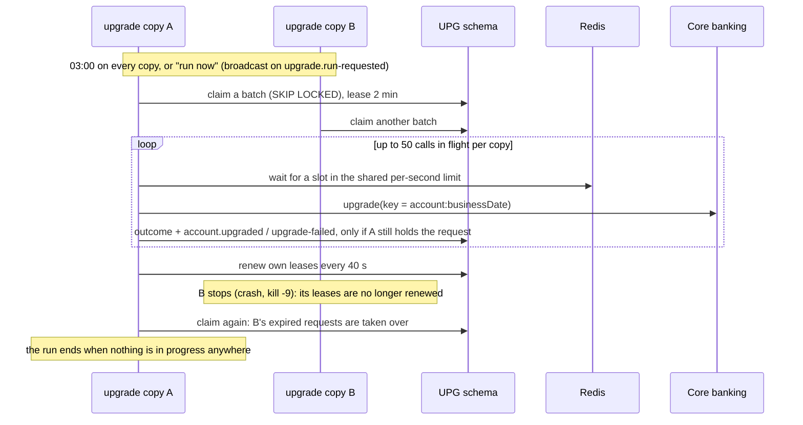
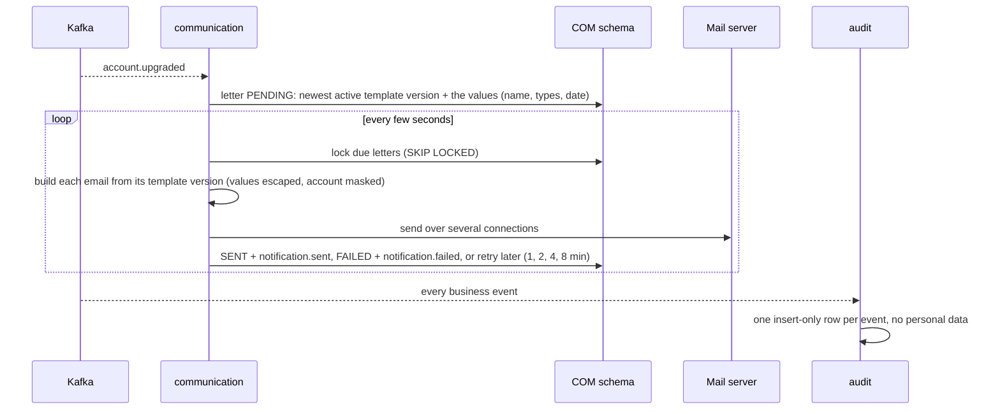
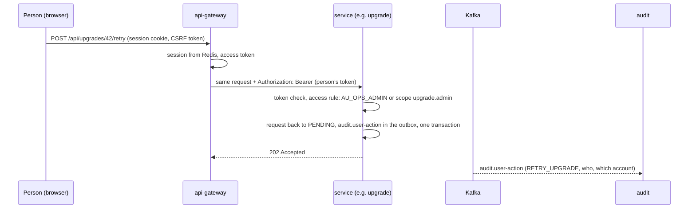

# Account Upgrade Platform: high-level design

| | |
|---|---|
| **Status** | As built, November 2026: `main` after PR #26, plus compact letters, partitioning and the audit archive (ADR-0020 to 0022). A learning project; see Risks and open items. |
| **Scope** | The nightly upgrade of bank accounts, from the Excel file to the welcome email and the audit trail, and the ops console around it |
| **Decisions** | The reasons behind this design are in the [decision records](adr/README.md) (ADR-0001 to ADR-0019) |
| **Details** | How to run, configure and operate each part: [README](../README.md) |

## 1. Purpose

Every night the bank sends a file of accounts that are due for an upgrade (for example from `SAVINGS` to
`SAVINGS_PLUS`). The platform:

1. loads the file and checks every row;
2. decides, per account, whether it is eligible, by the business's rules;
3. upgrades each eligible account in the core banking system;
4. emails each upgraded customer a welcome letter;
5. records every step in an audit trail;
6. lets the operations team watch all of this, and act on it, in an ops console.

## 2. System context

| External system | What the platform needs from it | Today |
|---|---|---|
| SFTP server | an `incoming` folder with the daily file, `processed` and `error` folders | atmoz/sftp in docker-compose |
| Core banking system | an upgrade call that accepts an idempotency key | **simulated** (`bank.upgrade.gateway=simulated`); the real adapter waits for the core team's API |
| Mail server | SMTP with STARTTLS | Mailpit in docker-compose |
| Identity provider | OIDC sign-in, client credentials, a `groups` claim, the audience `api://account-upgrade` | Keycloak 26 (ADR-0013) |

## 3. Services

| Service | Owns (Oracle schema) | Does | Runs |
|---|---|---|---|
| `file-ingestion-service` | `ING_OWNER`: file log, staging rows, rejected rows, Spring Batch records | picks up the file, loads it with Spring Batch, checks each row, announces `account.file-loaded`, streams a file's accounts to the upgrade service | 01:00, one instance at a time (ShedLock, ADR-0009) |
| `account-upgrade-service` | `UPG_OWNER`: upgrade requests | plans requests from a loaded file (eligible or rejected), runs the upgrade against the core system | planning on each file; the run at 03:00 on every copy (ADR-0010) |
| `communication-service` | `COM_OWNER`: letter templates, welcome letters | writes a letter for each upgrade (template version and values), builds and emails due letters, resend | continuously |
| `audit-service` | `AUD_OWNER`: audit events, archived months | records every business event, search API, moves months older than 400 days to archive files | continuously; archive at 05:00 |
| `api-gateway` | none (sessions in Redis) | signs people in, keeps their session, routes `/api/**` to the services with the person's token, serves the console | continuously |
| `common` (library) | shared tables in each schema: outbox, processed events | outbox, consumer template, security rules, correlation ids, retention, metrics | — |

Why it is split this way, and what that costs: ADR-0003. Why every service is reactive: ADR-0002.

## 4. The night, step by step

All times are in `bank.time-zone` (default `Asia/Kolkata`), never the server's zone.

| Time | What happens |
|---|---|
| 01:00 | Load: the ingestion service picks up `accounts_yyyyMMdd.xlsx` from SFTP |
| minutes later | Planning: the upgrade service turns the loaded accounts into upgrade requests |
| 03:00 | Upgrade run: every copy of the upgrade service joins; core-system calls |
| as upgrades finish | Letters are written and emailed; every event lands in the audit trail |
| 05:00 | Audit archive: months that ended more than 400 days ago go to checked files, then leave the table (ADR-0022) |
| 05:30 | Retention: every service drops old partitions, then deletes the old rows left (ADR-0019, ADR-0021) |
| any time | Ops console: watch progress, run a job now, retry an upgrade, resend an email |

### 4.1 Load and planning

Restart and duplicate handling: ADR-0006 (Spring Batch), ADR-0007 (the internal stream).

### 4.2 The upgrade run, with several copies

Outcomes: upgraded; refused (FAILED at once); unavailable (3 tries now, then the next run, FAILED after 3 runs).
Five unreachable accounts in a row stop the run. Details: ADR-0008, ADR-0010, ADR-0011, ADR-0012.

### 4.3 Letters, emails and the audit trail

### 4.4 An action in the ops console

## 5. Integration

### 5.1 Events (Kafka)

Every event is written to the producing service's outbox in the same transaction as the change it announces
(ADR-0004), and every consumer handles it once, retries with backoff and parks what still fails on `<topic>.DLT`
(ADR-0005). Events are keyed by what they are about (usually the account), so one account's events stay in order.

| Topic | Producer | Consumers | Meaning |
|---|---|---|---|
| `account.file-loaded` | ingestion | upgrade, audit | a file is completely loaded (id, date, counts) |
| `account.upgrade-rejected` | upgrade | audit | an account is not eligible, with the reason |
| `account.upgraded` | upgrade | communication, audit | the core system upgraded an account |
| `account.upgrade-failed` | upgrade | audit | refused, or gave up after the last attempt |
| `notification.sent` | communication | audit | a welcome email was accepted by the mail server |
| `notification.failed` | communication | audit | a welcome email failed for good |
| `audit.user-action` | ingestion, upgrade, communication | audit | a person ran a job, retried an upgrade or resent an email |
| `upgrade.run-requested` | upgrade | every upgrade copy (one group each) | "run now" broadcast (ADR-0011) |

Every event has the same envelope: `eventId`, `eventType`, `correlationId`, `occurredAt`, `actor`, `data`. The
correlation id also travels in HTTP headers (`X-Correlation-Id`) and every log line, so one business action (for
example one file) can be followed across services, logs and the audit trail.

### 5.2 Synchronous calls

| From | To | Call | Security |
|---|---|---|---|
| Browser | gateway | `/api/**`, `/me`, sign-in and sign-out | session cookie + CSRF token |
| gateway | each service | the same `/api/**` request | the person's access token (relayed) |
| upgrade | ingestion | `GET /internal/files/{id}/accounts` | the upgrade service's own token, scope `staging.read` |
| upgrade | core banking | upgrade an account | to be defined with the core team |
| Prometheus | each service | `GET /actuator/prometheus` | Prometheus's own token, scope `metrics.read` |

## 6. Data

Each service owns its schema and creates it with Liquibase; no service reads another's tables (ADR-0003).

| Schema | Main tables | Grows by | Partitioned by (ADR-0021) | Kept (ADR-0019) |
|---|---|---|---|---|
| `ING_OWNER` | `FILE_INGESTION_LOG`, `ACCOUNT_STAGING`, `INGESTION_ERROR`, `BATCH_*` | every row of every file | staging: one partition per file | staging and completed Batch records 30 days; file list and rejected rows kept |
| `UPG_OWNER` | `UPGRADE_REQUEST` | every account every day | month of business date | finished requests 400 days; pending never deleted |
| `COM_OWNER` | `LETTER_TEMPLATE` (versions never change), `WELCOME_LETTER` (template version and values, about 35 bytes; ADR-0020) | every upgraded account | month written | sent and failed letters 400 days |
| `AUD_OWNER` | `AUDIT_EVENT` (insert-only, no personal data), `AUDIT_ARCHIVE` | every business event | month of the event | 400 days in the table, then forever in archive files (ADR-0022) |
| each of the above | `OUTBOX_EVENT`, `PROCESSED_EVENT` | every event sent / handled | — | outbox 7 days after publishing; processed events 30 days |

The daily clean-up drops a whole partition once all its rows are past the period and none is still needed (a pending
request or letter keeps its month), then deletes the old rows left. Oracle adds partitions by itself. Without the
partitioning option (Oracle Standard Edition) the tables stay unpartitioned and the clean-up only deletes rows.

Personal data: names and emails live in staging rows, upgrade requests and letters only, all with retention. Letters
show only the last four digits of the account number. The audit trail holds codes, counts and masked text (ADR-0015).

## 7. Security

| Area | Design | ADR |
|---|---|---|
| Identity | one OIDC provider; Keycloak locally, Okta or Auth0 by settings only | 0013 |
| People | sign in at the gateway (authorization code + PKCE); sessions in Redis; tokens never reach the browser | 0014 |
| Roles | groups in the token: `AU_OPS_ADMIN`, `AU_OPS_VIEWER`, `AU_SUPPORT`, `AU_AUDITOR` | 0013 |
| Services | client credentials with narrow scopes: `staging.read`, `upgrade.read`, `upgrade.admin`, `audit.read`, `notification.resend`, `metrics.read` | 0013, 0016 |
| Rules | one access matrix for every service (`ApiAccessRules`): unknown `/api/**` calls refused, `/internal/**` for scopes only; checked by `AccessMatrixTest` | 0013 |
| Kafka | locally open; a secured profile with TLS, one SCRAM login per service and per-topic ACLs (`infra/kafka-secure`) | — |
| Secrets | local values are in the repo for local use only; every real secret comes from the environment (`IDP_CLIENT_SECRET`, `REDIS_PASSWORD`, `SMTP_PASSWORD`, `SFTP_PASSWORD` or a key, database passwords) | — |

Who may do what:

| Action | Ops admin | Viewer | Support | Auditor | Service scope |
|---|:-:|:-:|:-:|:-:|---|
| View files and upgrades | ✓ | ✓ | ✓ | ✓ | `upgrade.read` |
| View emails | ✓ | ✓ | ✓ | | |
| Search the audit trail | ✓ | | | ✓ | `audit.read` |
| Run a job now, retry an upgrade | ✓ | | | | `upgrade.admin` |
| Resend an email | ✓ | | ✓ | | `notification.resend` |
| Read a file's accounts (internal) | | | | | `staging.read` |
| Read metrics | | | | | `metrics.read` |

## 8. Quality attributes

### 8.1 Performance (local, one laptop, simulated core system)

| Run | Result |
|---|---|
| 20,000 accounts, core at 50 ms, one copy, before tuning | 1,245 s end to end |
| the same after three fixes (non-blocking core calls, parallel partitions, batched consuming) | 115 s end to end; upgrade 39 s |
| 20,000 accounts, three copies, shared limit 150 calls/s, one copy killed mid-run | all upgraded once; 176 s end to end |
| 2,000 accounts, end-to-end check (2026-11-06) | 18 s end to end |

Not yet measured: a million accounts (the largest Excel file). On an 8 GB laptop the full stack plus monitoring is
too much for honest numbers (ADR-0016).

### 8.2 Scaling

| Part | How it scales |
|---|---|
| Upgrade run | more copies share the run through leases; `bank.upgrade.concurrency` calls in flight per copy; one shared rate limit for the core system |
| Kafka consumers | partitions are handled in parallel, each in order (6 partitions per topic locally) |
| Outbox pollers, email senders | any number of instances; `SKIP LOCKED` keeps them off each other's rows |
| Load | one file at a time by design (ShedLock); Spring Batch chunks of 500 |
| Gateway | any number of copies; sessions in Redis |

### 8.3 What happens when something fails

| Failure | Behaviour |
|---|---|
| Core system down | 3 quick retries per account, then the account waits for the next run; 5 unreachable in a row stop the run; FAILED after 3 runs |
| Core system refuses an account | that account FAILED at once with the reason; the others continue |
| An upgrade copy dies | its requests are taken over by other copies after the 2-minute lease |
| The service stops between the core call and saving it | the request stays IN_PROGRESS; after the lease it is called again with the same idempotency key |
| Mail server down | letters wait and are retried after 1, 2, 4, 8 minutes; FAILED after 5 attempts; not counted as the service being DOWN |
| An address the mail server rejects | that letter FAILED at once |
| Kafka down | events wait in the outboxes (alert `OutboxFallingBehind`) and are sent when Kafka is back |
| An event that keeps failing | parked on `<topic>.DLT` (alert `EventDeadLettered`); fix and replay |
| A letter template that cannot be filled | the event is parked before any letter points at that version; activate a fixed version and replay |
| An audit archive file that does not read back complete | nothing is dropped; the month stays in the table and is tried again the next day |
| Rows of an audit month change after it was archived | nothing is dropped; alert `AuditArchiveProblem` for a person to decide |
| The same event twice | recorded once (processed-event table, unique keys) |
| A bad row in the file | rejected with its problems; the rest of the file loads |
| A file that cannot load (not a workbook, a column missing) | marked FAILED, moved to `error` |
| The same file again (another name) | moved to `error` as `.duplicate` |
| Load stopped half way | the next run resumes after the last committed chunk |
| Ingestion down during planning | the event is retried with backoff |
| Redis down | gateway: no sign-in; upgrade: calls go ahead without the shared limit (ADR-0012) |
| Oracle down | everything waits and retries; scheduled jobs try again at their next time |

Delivery guarantees: events at least once, handled once; core calls at least once, made safe by the idempotency
key; emails at least once (a crash after the mail server accepted but before the commit sends again).

### 8.4 Observability

- **Metrics:** every service exposes Micrometer metrics to Prometheus, including the pipeline's own (core calls by
  outcome, limit waits, finished requests, lease takeovers, outbox backlog, events by result, emails, retention,
  partitions dropped, audit months archived).
- **Dashboard:** "Account upgrade" in Grafana, a file in the repo; sign-in through Keycloak.
- **Alerts:** eight rules (service down, dead-lettered event, Kafka lag, outbox stuck, core system unavailable,
  upgrade copy died, emails failing, audit archive problem), emailed by Alertmanager (ADR-0016).
- **Tracing a business action:** the correlation id in every event, HTTP call, log line and audit row.
- **Audit trail:** who did what and when, searchable by account, action, type or person (ADR-0015); older months
  in checked archive files, listed with their SHA-256 (ADR-0022).

## 9. Technology

| Area | Choice | Version | Note |
|---|---|---|---|
| Language | Java | 21 | |
| Framework | Spring Boot, WebFlux | 3.5.6 | **out of free support since 2026-06-30**; latest stable is 4.1 (Risks) |
| Gateway | Spring Cloud Gateway | Spring Cloud 2025.0.0 | |
| Kafka client | reactor-kafka | 1.3.25 | no longer developed by the Reactor team (Risks) |
| Batch | Spring Batch | 5.x (with Boot 3.5) | |
| Persistence | JPA (Hibernate), JDBC, Liquibase | with Boot 3.5 | |
| Database | Oracle | Free 23 locally | production edition and hosting to decide; partitioning needs Enterprise Edition with the Partitioning option |
| Messaging | Apache Kafka | 3.9 | |
| Cache / sessions | Redis | 7.4 | |
| Identity | Keycloak | 26.4 | Okta or Auth0 possible |
| Excel | Apache POI, excel-streaming-reader | 6.0 | |
| SFTP | sshj | 0.41 | |
| Console | React, TypeScript, Vite | 18.3, 5.6, 5.4 | built by Maven with Node 22 |
| Monitoring | Prometheus, Grafana, Alertmanager | 3.15, 13.2, 0.34 | |
| Tests | JUnit 5, Mockito, Spring test slices, BlockHound | | no containers or databases (ADR-0017) |

## 10. Environments and delivery

| Environment | What runs | How |
|---|---|---|
| Local | the services (IntelliJ or `java -jar`), Oracle, Kafka, Kafka UI, SFTP, Mailpit, Keycloak, Redis, Prometheus, Alertmanager, Grafana | `docker compose up -d`, profile `local`; `perf/run.sh` for end-to-end runs |
| CI | build, unit and API tests, coverage (JaCoCo), SonarCloud | GitHub Actions on every pull request into `main` |
| Security checks | OWASP dependency-check, weekly | GitHub Actions; waiting for the `NVD_API_KEY` secret |
| Dependency updates | Dependabot, minor and patch only | paused (ADR-0018) |
| Cloud | not decided | planned for Google Cloud after local testing |

Decisions the cloud move needs (to become ADRs): where Oracle runs (stay on-premises, or a VM with Oracle, or another
database), Kafka (self-run or a managed service), Kubernetes (GKE) or Cloud Run, how secrets are stored, how
Prometheus reaches the services (the scope, or a protected management port), and backups.

## 11. Risks and open items

| Item | Impact | Next step |
|---|---|---|
| Spring Boot 3.5 has had no free fixes since 2026-06-30 | security fixes missing | move to 3.5.16 now; plan the migration to 4.1 (Spring Framework 7, Jackson 3, Spring Batch 6, Hibernate 7) |
| reactor-kafka is no longer developed | blocks or complicates later upgrades | evaluate Spring Kafka, or the plain Kafka client on virtual threads, during the Boot 4 migration |
| Tests do not touch Oracle, Kafka or Redis (ADR-0017) | SQL, concurrency and broker behaviour are checked by hand only | a local end-to-end run before every release; consider a separate container suite |
| Core banking adapter, business rules, letter wording and Excel layout are drafts | not production-ready | needs the core team's API and the business's confirmed rules |
| Idempotency of the core system's API not confirmed | double upgrades on retries | confirm with the core team |
| Fail-open rate limit (ADR-0012) | a Redis outage can exceed the core team's limit | confirm fail-open or fail-closed with the core team |
| Retention periods are a starting point | keeping data too long or too short | confirm with compliance |
| Partitioning is a paid Oracle option | without it, old data is deleted row by row and the audit trail stays in its table | decide the production edition; the code works either way |
| Audit archive files are the only copy of old months | a lost file loses a month of the trail | durable, backed-up storage, ideally a write-once bucket (another `ArchiveStore`) |
| Old audit months are not searchable in the console | finding old history means reading a file | a restore tool that loads a month back, if auditors need it |
| A million accounts not measured | unknown limits | run `perf/run.sh 1000000` on a machine with more memory |
| Dependabot paused, OWASP check waiting for a key | updates and vulnerabilities not reported | resume Dependabot; add `NVD_API_KEY` |

## 12. Glossary

| Term | Meaning |
|---|---|
| Business date | the day a file is for (from its name), not the day it runs |
| Upgrade request | one account's upgrade for one business date: PENDING, IN_PROGRESS, UPGRADED, REJECTED or FAILED |
| Run | one pass of the upgrade over everything PENDING; several copies can share it |
| Copy | one running process of a service; the upgrade service is designed for several |
| Lease | a copy's time-limited claim on a request (`CLAIMED_BY`, `CLAIMED_UNTIL`) |
| Outbox | a table where events wait, written with the change they announce |
| DLT | dead-letter topic, `<topic>.DLT`, where events that keep failing are parked |
| Correlation id | the id that ties one business action together across services, events, logs and the audit trail |
| Scope / role | what a service's token / a person's groups allow |
